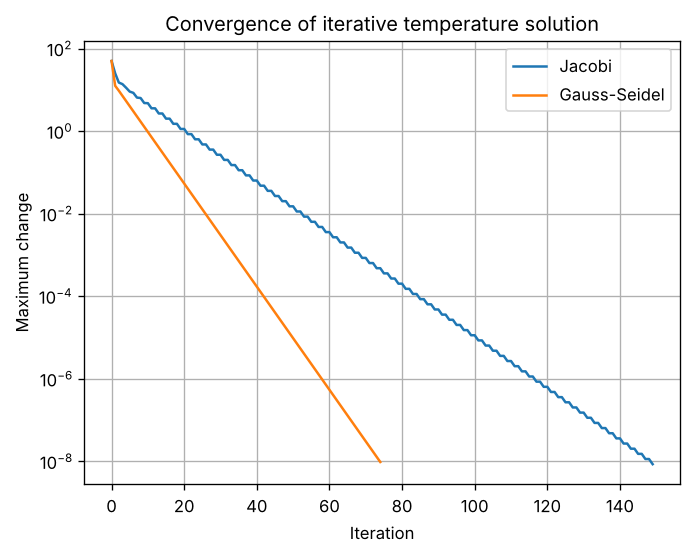
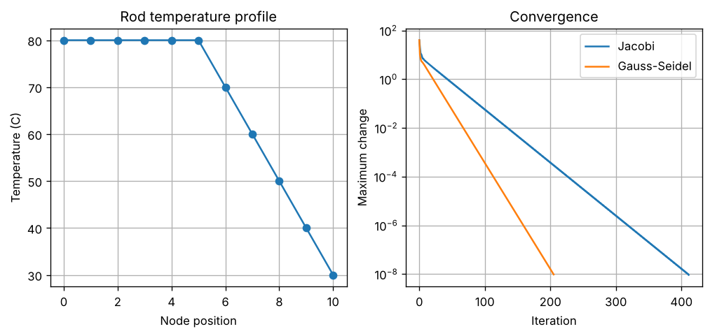

# Task 8: Iterative Methods for Linear Systems

*Programs:* `code/Task_08_iterative_linear.py` (original) and `code/Task_08_modified.py` (parameter change + new case). Run from inside the `code/` folder.

## 1. Inputs and mathematical operation
A 5×5 tridiagonal matrix (2 on the diagonal, −1 beside it) and b = [100,0,0,0,20] (boundary temperatures). Operations: Jacobi (uses only the previous iterate) and Gauss–Seidel (uses updated values immediately), stopping when the largest change is below 1e-8.

## 2. Original output and its meaning
```text
Jacobi temperatures: [86.66666665 73.33333331 59.99999997 46.66666664 33.33333332]
Gauss-Seidel temperatures: [86.66666665 73.3333333  59.99999997 46.66666665 33.33333332]
Direct solution: [86.66666667 73.33333333 60.         46.66666667 33.33333333]
Jacobi iterations: 150
Gauss-Seidel iterations: 75
```
Both methods converge to temperatures 86.67, 73.33, 60, 46.67, 33.33 °C, the same as the direct solve. The temperature falls linearly from the hot (100 °C) to the cold (20 °C) boundary, as expected for steady heat flow in a uniform rod.

## 3. Parameter change and how the result changes
Loosening the tolerance from 1e-8 to 1e-3 cut iterations from 150 to 70 (Jacobi) and 75 to 35 (Gauss–Seidel). Gauss–Seidel needs about half as many iterations as Jacobi. Raising the hot boundary to 150 °C shifts the whole profile upward (128.3 … 41.7 °C) without changing the iteration count (linear system, same matrix).

## 4. Modified program: new real-world case
**Assumptions, inputs and data:** A rod with 9 interior nodes; ends held at 80 °C and 30 °C; an extra source term of 10 at the middle node. Note that this simple source term only illustrates a perturbation; a physical heater would need unit and scaling decisions.

**Output of `Task_08_modified.py`:**
```text
=== PART 1: Parameter changes (5-node model) ===
tol=0.001: Jacobi 70 iterations, Gauss-Seidel 35 iterations
tol=1e-08: Jacobi 150 iterations, Gauss-Seidel 75 iterations
Left boundary 150 C -> [128.333 106.667  85.     63.333  41.667]

=== PART 2: Rod with 9 interior nodes, ends 80 C and 30 C, heater at node 5 ===
Direct solution      : [80. 80. 80. 80. 80. 70. 60. 50. 40.]
Jacobi solution      : [80. 80. 80. 80. 80. 70. 60. 50. 40.] (412 iterations)
Gauss-Seidel solution: [80. 80. 80. 80. 80. 70. 60. 50. 40.] (206 iterations)
Max difference iterative vs direct: 9.67e-08
```
**Interpretation:** The solution is 80 °C up to node 5, then 70, 60, 50, 40 °C towards the cold end. Jacobi needs 412 iterations and Gauss–Seidel 206 to reach tolerance 1e-8, matching the direct solution to about 1e-7. The convergence plot is a straight line on a log axis (linear convergence), with Gauss–Seidel steeper, i.e. faster.

### Graphs




Figures are saved by the programs in `figures/`; see the interpretation above for how to read them.
