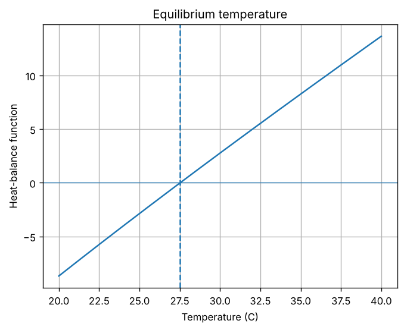
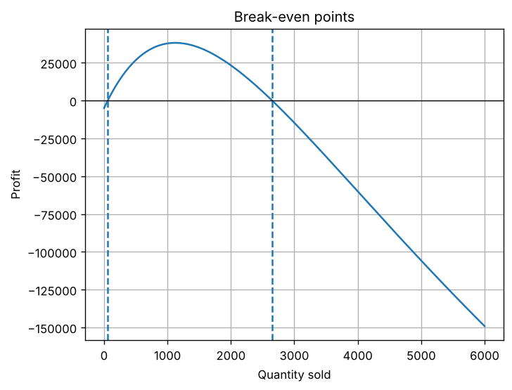

# Task 10: Root Finding: Bisection and Fixed-Point Methods

*Programs:* `code/Task_10_bisection_fixed_point.py` (original) and `code/Task_10_modified.py` (parameter change + new case). Run from inside the `code/` folder.

## 1. Inputs and mathematical operation
f(T) = T − 25 − 10e^(−T/20), bracket [20, 40] with sign change; fixed-point form g(T) = 25 + 10e^(−T/20), start T = 30. Operations: repeated interval halving; repeated substitution T ← g(T).

## 2. Original output and its meaning
```text
Bisection equilibrium temperature: 27.525211 C
Fixed-point equilibrium temperature: 27.525211 C
Fixed-point iterations: 13
Bisection iterations: 38
```
Both methods give an equilibrium temperature of 27.525211 °C, the temperature at which heat gain equals heat loss. Bisection needed 38 iterations; fixed-point only 13 because |g′| ≈ 0.13 near the root (fast contraction). On the graph the curve crosses zero at the dashed line.

## 3. Parameter change and how the result changes
Starting T₀ at 20 or 100 still gave 27.525211 (14 iterations): convergence does not depend on the start. Tightening bisection's tolerance from 1e-2 to 1e-10 raised iterations from 11 to 38 (each halving gives ≈ one more binary digit). Changing the coefficient from 10 to 500 makes |g′(root)| = 1.54 > 1, so fixed-point iterates oscillate and diverge (66, 43, 82, 33, 120, …) while bisection still finds 55.7648.

## 4. Modified program: new real-world case
**Assumptions, inputs and data:** Break-even of a product whose price falls with volume: revenue = 120·q·e^(−q/2000), cost = 5000 + 30q. Profit(q) = revenue − cost. There are two break-even points, so two brackets are used. All numbers are illustrative.

**Output of `Task_10_modified.py`:**
```text
=== PART 1: Parameter changes ===
start T0= 30.0: root=27.525211 in 13 iterations
start T0= 20.0: root=27.525211 in 14 iterations
start T0=100.0: root=27.525211 in 14 iterations
coefficient 500: exact root (bisection) = 55.7648; |g'(root)| = 1.54 > 1
fixed-point iterates: 66.04 43.40 82.08 33.25 119.82 26.25 159.57 25.17 
-> the iterates oscillate away from the root (fixed-point fails); bisection still works
bisection xtol=0.01: iterations=11
bisection xtol=1e-06: iterations=25
bisection xtol=1e-10: iterations=38

=== PART 2: Break-even analysis ===
Lower break-even quantity: 57.75 units (29 iterations)
Upper break-even quantity: 2650.63 units (32 iterations)
Profitable between 58 and 2651 units; max profit ~38,171 near q=1122
```
**Interpretation:** Break-even at ≈ 57.75 units and ≈ 2650.63 units. The product makes a profit only between them, with a maximum profit of about 38,000 near 1,100 units. Below the lower point fixed costs are not recovered; above the upper point the falling price makes extra sales unprofitable.

### Graphs




Figures are saved by the programs in `figures/`; see the interpretation above for how to read them.
