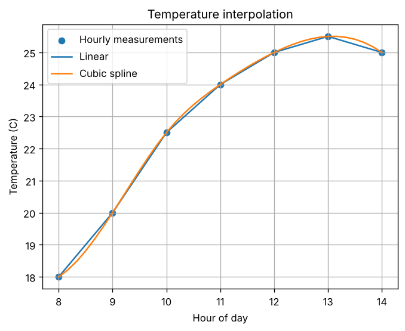
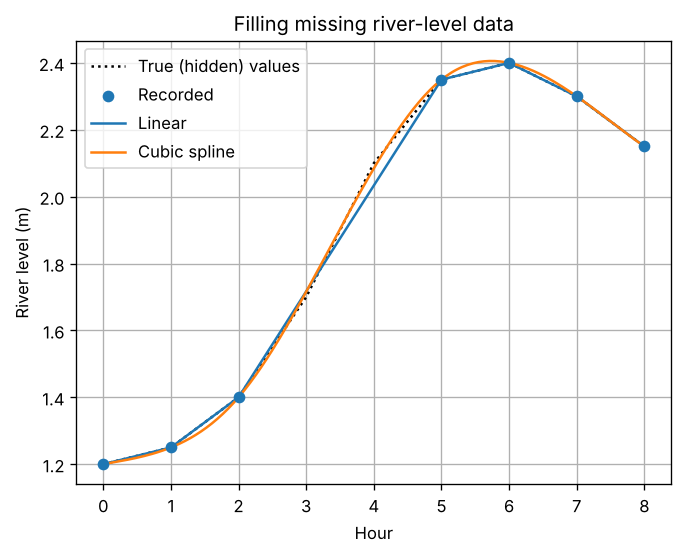

# Task 13: Interpolation

*Programs:* `code/Task_13_interpolation.py` (original) and `code/Task_13_modified.py` (parameter change + new case). Run from inside the `code/` folder.

## 1. Inputs and mathematical operation
Hourly temperatures 08:00–14:00. Linear interpolation (straight lines between neighbours) and a cubic spline (smooth piecewise cubic) evaluated at 10-minute intervals. (I clip the generated time grid to ≤ 14.0 because `np.arange` with 1/6 steps can overshoot the last data point, which `interp1d` rejects.)

## 2. Original output and its meaning
```text
Linear estimate at 10:30: 23.25 C
Cubic estimate at 10:30: 23.36 C
```
At 10:30 the linear estimate is 23.25 °C and the cubic 23.36 °C. Linear is the average of 22.5 and 24.0; the spline follows the curvature of the cooling/warming trend, so it is slightly higher. In the graph the spline is smooth while the linear estimate has corners at the data points.

## 3. Parameter change and how the result changes
Changing the 11:00 value from 24.0 to 30.0 (outlier) moves the 10:30 estimate to 26.25 (linear) and 27.01 (cubic): the spline spreads the outlier's influence over a wider region. Extrapolating the spline to 16:00 gives 18.75 °C, a nonsense drop, so interpolation should not be used outside the data range.

## 4. Modified program: new real-world case
**Assumptions, inputs and data:** River level (m) measured hourly for 9 hours; the readings at hours 3 and 4 are lost. Synthetic 'true' values are kept so the estimates can be checked.

**Output of `Task_13_modified.py`:**
```text
=== PART 1: Parameter changes ===
original                         t=10.5: linear=23.25  cubic=23.36
original                         t=13.5: linear=25.25  cubic=25.41
outlier at 11:00 (24.0 -> 30.0)  t=10.5: linear=26.25  cubic=27.01
outlier at 11:00 (24.0 -> 30.0)  t=13.5: linear=25.25  cubic=26.37
Extrapolation test, cubic at 16:00 = 18.75 (unreliable outside data range)

=== PART 2: River level with two missing readings ===
hour 3: true=1.70 m  linear=1.72 m (err 0.02)  cubic=1.72 m (err 0.02)
hour 4: true=2.10 m  linear=2.03 m (err 0.07)  cubic=2.08 m (err 0.02)
```
**Interpretation:** Linear error: 0.02 m (hour 3) and 0.07 m (hour 4); cubic: 0.02 m and 0.02 m. The spline recovers the rising curve better because the level is accelerating then flattening. The plot shows the estimates close to the hidden true values.

### Graphs




Figures are saved by the programs in `figures/`; see the interpretation above for how to read them.
