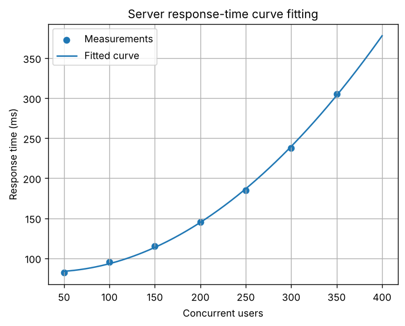
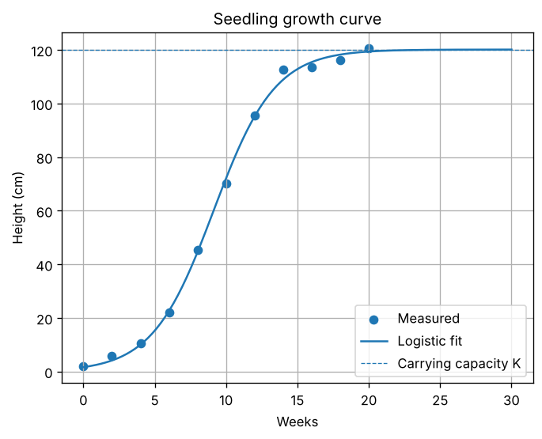

# Task 14: Curve Fitting and Approximation

*Programs:* `code/Task_14_curve_fitting.py` (original) and `code/Task_14_modified.py` (parameter change + new case). Run from inside the `code/` folder.

## 1. Inputs and mathematical operation
Users 50–350 and response times 82–305 ms. Model y = ax² + bx + c fitted by `curve_fit` (least squares, minimising Σ(yᵢ − ŷᵢ)²). Output: parameters, RMSE and a prediction at 400 users.

## 2. Original output and its meaning
```text
Fitted model: y = 0.002167x^2 + -0.1345x + 85.00
RMSE: 1.55 ms
Predicted response at 400 users: 377.86 ms
```
y ≈ 0.002167x² − 0.1345x + 85.00 with RMSE 1.55 ms: the curve passes within about 1.5 ms of the measurements. Predicted response at 400 users ≈ 377.9 ms. The positive x² term means delay grows faster as load rises.

## 3. Parameter change and how the result changes
Changing the model: a straight line has RMSE 18.8 ms (underfits the curvature); a cubic has RMSE 0.14 ms (but only because it has more parameters than the data justify and can overfit); an exponential gives 1.43 ms. Predictions at 400 users range from 313 ms (linear) to 400 ms (exponential), so extrapolation depends strongly on the model.

## 4. Modified program: new real-world case
**Assumptions, inputs and data:** Logistic growth of a seedling's height: h(t) = K/(1 + e^(−r(t−t₀))). Data are synthetic: true K = 120 cm, r = 0.45/week, t₀ = 9 weeks, plus random noise (SD 3 cm, seed 7).

**Output of `Task_14_modified.py`:**
```text
=== PART 1: Different models for the server data ===
degree 1: RMSE= 18.83 ms   prediction at 400 users= 312.86 ms
degree 2: RMSE=  1.55 ms   prediction at 400 users= 377.86 ms
degree 3: RMSE=  0.14 ms   prediction at 400 users= 387.86 ms
exponential a*exp(bx)+c: RMSE=1.43 ms, prediction at 400 users=400.36 ms

=== PART 2: Logistic growth of seedling height ===
Fitted: K=120.1 cm (+/-1.3), r=0.467/week (+/-0.020), t0=9.13 weeks (+/-0.11)
RMSE: 1.67 cm
Height predicted at week 30: 120.1 cm   | weeks to reach 90% of K: 13.8
```
**Interpretation:** The fit recovers K ≈ 120.1 ± 1.3 cm, r ≈ 0.467 ± 0.020 /week, t₀ ≈ 9.1 weeks, RMSE 1.67 cm (close to the noise level, which is a good sign). The seedling reaches 90% of its final height after about 13.8 weeks and levels off near 120 cm. The plot shows the S-shaped curve through the points.

### Graphs




Figures are saved by the programs in `figures/`; see the interpretation above for how to read them.
