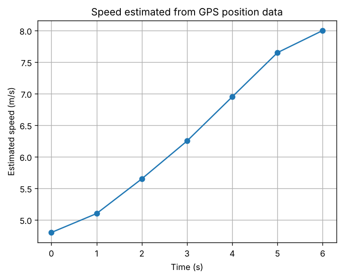
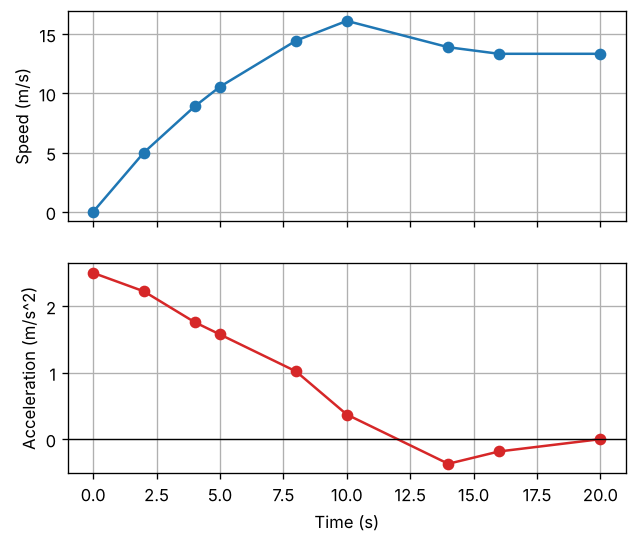

# Task 15: Numerical Differentiation

*Programs:* `code/Task_15_numerical_differentiation.py` (original) and `code/Task_15_modified.py` (parameter change + new case). Run from inside the `code/` folder.

## 1. Inputs and mathematical operation
GPS times 0–6 s and positions in metres. Forward difference at the start, central differences in the middle, backward difference at the end, giving speed = Δposition/Δtime.

## 2. Original output and its meaning
```text
t=0s, position=0.0m, estimated speed=4.80m/s
t=1s, position=4.8m, estimated speed=5.10m/s
t=2s, position=10.2m, estimated speed=5.65m/s
t=3s, position=16.1m, estimated speed=6.25m/s
t=4s, position=22.7m, estimated speed=6.95m/s
t=5s, position=30.0m, estimated speed=7.65m/s
t=6s, position=38.0m, estimated speed=8.00m/s
```
Estimated speed rises from 4.8 m/s to 8.0 m/s: the vehicle is accelerating. The end values use one-sided differences and are less accurate than the central ones.

## 3. Parameter change and how the result changes
Testing step size h on sin(x) at x = 1 (exact derivative cos 1): the central-difference error falls about 100× for every 10× smaller h (second-order), the forward error only 10× (first-order). But for very small h (1e-10, 1e-14) round-off dominates and the error rises again (3.7e-3 at h = 1e-14): there is an optimal h.

## 4. Modified program: new real-world case
**Assumptions, inputs and data:** A matatu's speed (km/h) sampled at irregular times (0–20 s). Convert to m/s and compute acceleration with `np.gradient`, which handles uneven spacing.

**Output of `Task_15_modified.py`:**
```text
=== PART 1: Effect of h on d/dx sin(x) at x = 1 (exact = cos(1)) ===
       h   forward err   central err
   1e+00     4.725e-01     8.565e-02
   1e-01     4.294e-02     9.001e-04
   1e-02     4.216e-03     9.005e-06
   1e-03     4.208e-04     9.005e-08
   1e-06     4.207e-07     2.772e-11
   1e-10     5.848e-08     5.848e-08
   1e-14     3.707e-03     3.707e-03

=== PART 2: Matatu acceleration ===
t=   0s  speed= 0.00 m/s  acceleration=  2.50 m/s^2
t=   2s  speed= 5.00 m/s  acceleration=  2.22 m/s^2
t=   4s  speed= 8.89 m/s  acceleration=  1.76 m/s^2
t=   5s  speed=10.56 m/s  acceleration=  1.57 m/s^2
t=   8s  speed=14.44 m/s  acceleration=  1.02 m/s^2
t=  10s  speed=16.11 m/s  acceleration=  0.37 m/s^2
t=  14s  speed=13.89 m/s  acceleration= -0.37 m/s^2
t=  16s  speed=13.33 m/s  acceleration= -0.19 m/s^2
t=  20s  speed=13.33 m/s  acceleration=  0.00 m/s^2
Maximum acceleration: 2.50 m/s^2 at t=0s
Maximum braking: -0.37 m/s^2 at t=14s
```
**Interpretation:** Acceleration starts at about 2.5 m/s², decreases to 0.37 m/s² at 10 s, then becomes negative (about −0.37 m/s² at 14 s, easing off) before cruising at 13.33 m/s with zero acceleration. The acceleration curve shows the driver's behaviour more clearly than speed alone.

### Graphs




Figures are saved by the programs in `figures/`; see the interpretation above for how to read them.
