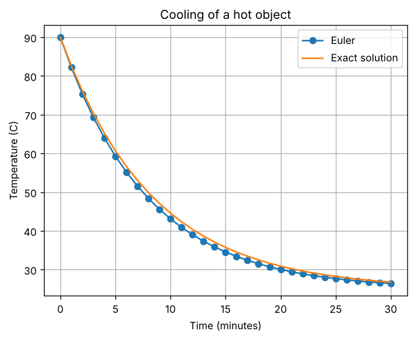
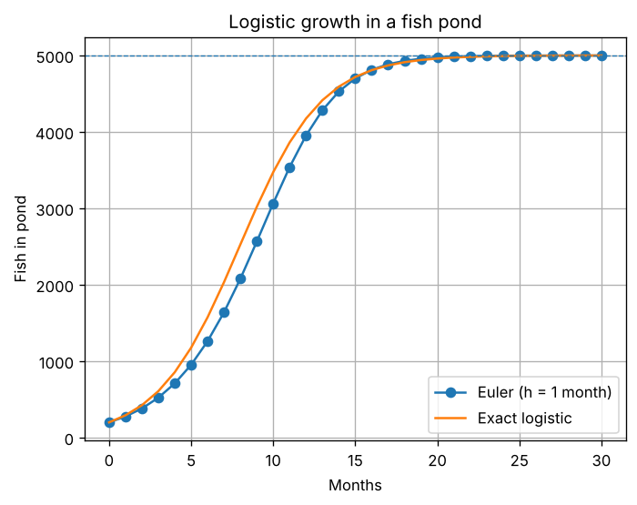

# Task 17: Ordinary Differential Equations – Euler Method

*Programs:* `code/Task_17_euler_ode.py` (original) and `code/Task_17_modified.py` (parameter change + new case). Run from inside the `code/` folder.

## 1. Inputs and mathematical operation
dT/dt = −k(T − T_amb), T_amb = 25 °C, T₀ = 90 °C, k = 0.12 /min, step h = 1 min, 30 minutes. Euler: Tₙ₊₁ = Tₙ + h·f(Tₙ).

## 2. Original output and its meaning
```text
Euler temperature after 30 min: 26.40 C
Exact temperature after 30 min: 26.78 C
Final absolute error: 0.3720 C
```
After 30 minutes Euler gives 26.40 °C versus the exact 26.78 °C (error 0.37 °C). Euler underestimates the temperature because it uses the slope at the start of each step, which is steeper than the average slope in the step. The graph shows the object cooling exponentially towards 25 °C with Euler slightly below the exact curve.

## 3. Parameter change and how the result changes
Step size: h = 5, 2, 1, 0.5, 0.1 min gave errors of 1.51, 0.72, 0.37, 0.19, 0.038 °C: error is proportional to h (first-order). With a larger k = 0.3 and h = 10 (h·k = 3 > 2) Euler becomes unstable and oscillates (90, −105, 285, −495): a step size must be small enough for stability.

## 4. Modified program: new real-world case
**Assumptions, inputs and data:** Logistic growth of fish in a pond: dP/dt = rP(1 − P/K) with r = 0.4 per month, K = 5000 fish, P₀ = 200, h = 1 month, 30 months. Exact logistic solution is available for comparison.

**Output of `Task_17_modified.py`:**
```text
=== PART 1: Parameter changes ===
h= 5.0 min: Euler T(30)= 25.27 C  exact=26.78 C  error=1.5098
h= 2.0 min: Euler T(30)= 26.06 C  exact=26.78 C  error=0.7165
h= 1.0 min: Euler T(30)= 26.40 C  exact=26.78 C  error=0.3720
h= 0.5 min: Euler T(30)= 26.59 C  exact=26.78 C  error=0.1890
h= 0.1 min: Euler T(30)= 26.74 C  exact=26.78 C  error=0.0383
k=0.30 (faster cooling): Euler T(30)=25.00 C, exact 25.01 C
h=10 with k=0.30 (h*k=3 > 2): Euler values [  90. -105.  285. -495.] -> unstable oscillation

=== PART 2: Logistic population growth of a fish pond (tilapia) ===
Euler population after 30 months: 4999.8
Exact population after 30 months: 4999.3
Maximum absolute error over the run: 454.5 fish
Month when Euler population first exceeds K/2: 9 (exact: 7.9)
```
**Interpretation:** Euler reaches 4999.8 vs 4999.3 exact at month 30, but the largest error during the run is ≈ 455 fish during the fast-growth stage, and Euler passes K/2 at month 9 instead of about 7.9. The S-curve and the carrying capacity are captured, but Euler lags during rapid growth; a smaller step or a better method would reduce the lag.

### Graphs




Figures are saved by the programs in `figures/`; see the interpretation above for how to read them.
