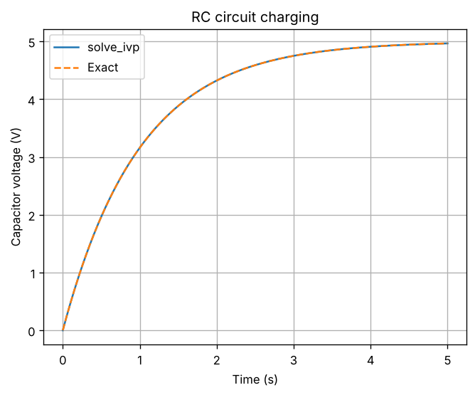
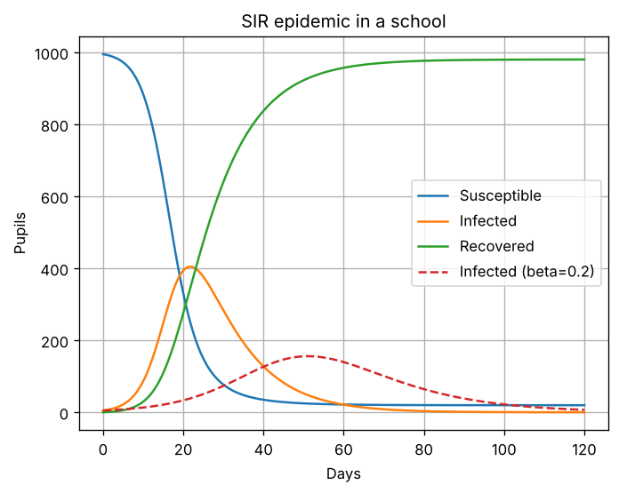

# Task 18: Numerical Solution of ODEs Using SciPy

*Programs:* `code/Task_18_scipy_ode.py` (original) and `code/Task_18_modified.py` (parameter change + new case). Run from inside the `code/` folder.

## 1. Inputs and mathematical operation
RC circuit: dV/dt = (Vs − V)/(RC), Vs = 5 V, R = 1000 Ω, C = 0.001 F (τ = RC = 1 s), V₀ = 0. `solve_ivp` with rtol 1e-9 and atol 1e-11 over 0–5 s.

## 2. Original output and its meaning
```text
Solver success: True
Capacitor voltage at 5 s: 4.9663 V
Maximum error against exact solution: 9.282e-10 V
```
The capacitor charges to 4.9663 V after 5 s (99.3% of 5 V, since e^−5 ≈ 0.0067). Maximum error against the exact curve is 9.3e-10 V, so the solver is extremely accurate. The graph shows an exponential rise that flattens near 5 V; solver and exact curves overlap.

## 3. Parameter change and how the result changes
Doubling R to 2000 Ω doubles τ to 2 s: V(1 s) drops from 3.16 V to 1.97 V and V(5 s) from 4.97 V to 4.59 V (slower charging). Loosening the tolerance to 1e-2 reduced function evaluations from 362 to 50 but the error rose to about 7e-3 V: tolerance trades accuracy for work.

## 4. Modified program: new real-world case
**Assumptions, inputs and data:** SIR epidemic in a school of N = 1000: dS/dt = −βSI/N, dI/dt = βSI/N − γI, dR/dt = γI. β = 0.4/day, γ = 0.1/day (R₀ = 4), 5 initially infected. A second run uses β = 0.2 (R₀ = 2) to represent control measures.

**Output of `Task_18_modified.py`:**
```text
=== PART 1: Parameter changes (RC circuit) ===
R=  1000 ohm: tau=1.0 s  V(1 s)=3.161 V  V(5 s)=4.9663 V
R=  2000 ohm: tau=2.0 s  V(1 s)=1.967 V  V(5 s)=4.5896 V
rtol=1e-09: function evaluations=362, max error=1.14e-09 V
rtol=0.01: function evaluations=50, max error=7.37e-03 V

=== PART 2: SIR epidemic, N = 1000, beta = 0.4/day, gamma = 0.1/day ===
R0 = beta/gamma = 4.0
Peak infections: 405 pupils on day 21.8
Final number ever infected: 980 (98.0%)
Conservation check S+I+R at the end: 1000.000000
With measures (beta = 0.2, R0 = 2): peak 156, total infected 787
```
**Interpretation:** Infections peak at about 405 pupils on day 21.8, and 98% eventually become infected. With β = 0.2 the peak falls to about 156 and total infections to 787: reducing transmission flattens the curve. S + I + R = 1000 throughout (conservation check). Simplified model: no births, immunity loss or age structure.

### Graphs




Figures are saved by the programs in `figures/`; see the interpretation above for how to read them.
