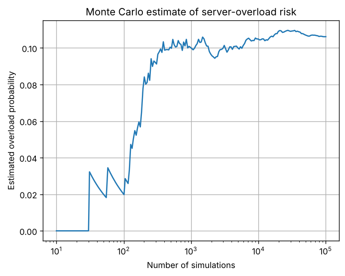
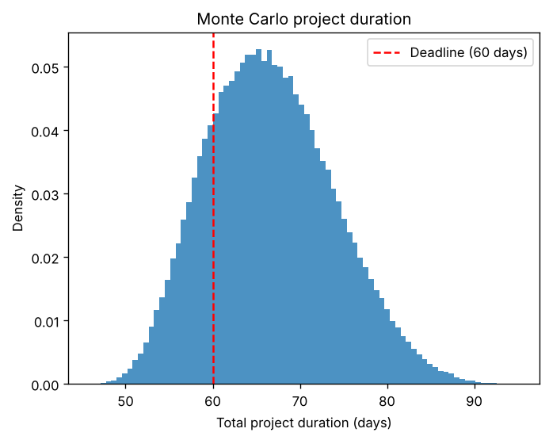

# Task 20: Random Numbers and Monte Carlo Methods

*Programs:* `code/Task_20_monte_carlo.py` (original) and `code/Task_20_modified.py` (parameter change + new case). Run from inside the `code/` folder.

## 1. Inputs and mathematical operation
Demand ~ Normal(850, 120), capacity 1000, 100,000 simulations (seed 42). Overload probability = fraction of scenarios with demand > capacity.

## 2. Original output and its meaning
```text
Estimated overload probability: 10.6160%
Number of overload cases: 10616 out of 100000
```
Estimated overload probability 10.62% (10,616 of 100,000 scenarios). The exact value from the normal distribution is 10.57%, so the simulation error is about 0.05 percentage points. The convergence plot is noisy for small N and settles near 10.6% as N grows.

## 3. Parameter change and how the result changes
Capacity 1100 → 1.91% (exact 1.86%); standard deviation 200 → 22.6% (exact 22.66%): more uncertainty means more risk. With only 1,000 simulations different seeds give 8.7%–11.6%, but with a million simulations they agree to about ±0.05 points: the Monte Carlo error shrinks like 1/√N.

## 4. Modified program: new real-world case
**Assumptions, inputs and data:** Three construction stages in sequence with triangular duration distributions (min, most likely, max): foundation (15, 20, 35), walls (20, 25, 45), roof (8, 12, 20) days. 200,000 simulations, deadline 60 days. Estimates are assumptions.

**Output of `Task_20_modified.py`:**
```text
=== PART 1: Parameter changes (server overload) ===
original                     : 10.6160%   (exact normal tail 10.5650%)
capacity 1100                : 1.9120%   (exact 1.8610%)
std 200 (more uncertainty)   : 22.6020%   (exact 22.6627%)
N = 1,000 with 5 different seeds: ['9.70%', '8.70%', '10.90%', '11.60%', '11.10%']
N = 1,000,000, seeds 0-4      : ['10.566%', '10.498%', '10.577%', '10.597%', '10.546%']

=== PART 2: Project finishing time (days) ===
Mean total duration: 66.6 days, standard deviation 7.3
Probability of finishing within 60 days: 19.35%
90th percentile duration: 76.5 days (90% of simulated projects finish by then)
Planned 'most likely' duration (20+25+12): 57 days
```
**Interpretation:** Mean total duration 66.6 days (SD 7.3), above the 'most likely' plan of 57 days because each distribution is right-skewed. The probability of finishing within 60 days is only 19.4%; 90% of simulated projects finish by day 76.5. A plan based on most-likely times is over-optimistic.

### Graphs




Figures are saved by the programs in `figures/`; see the interpretation above for how to read them.
